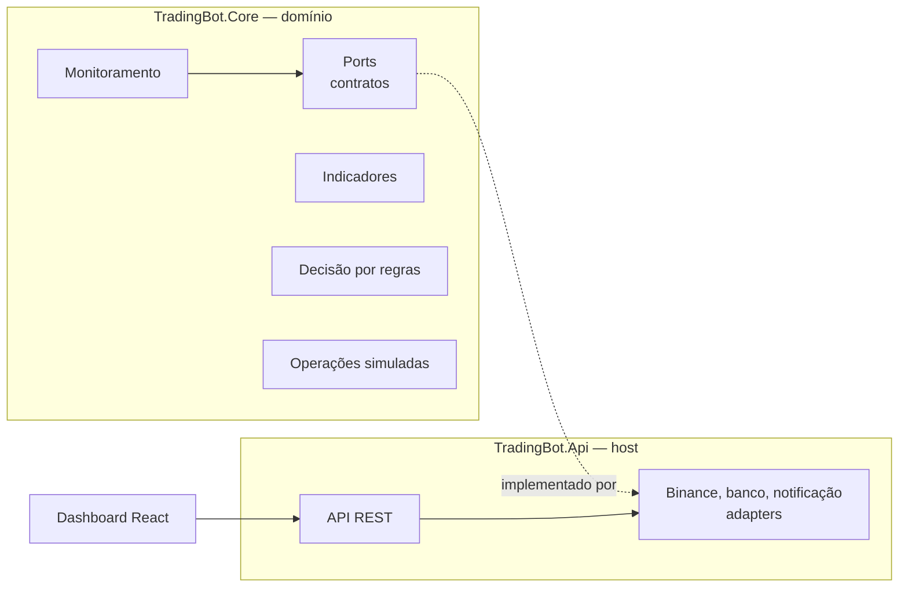
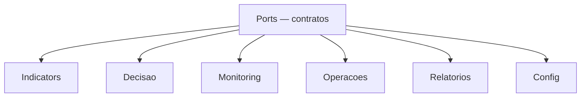
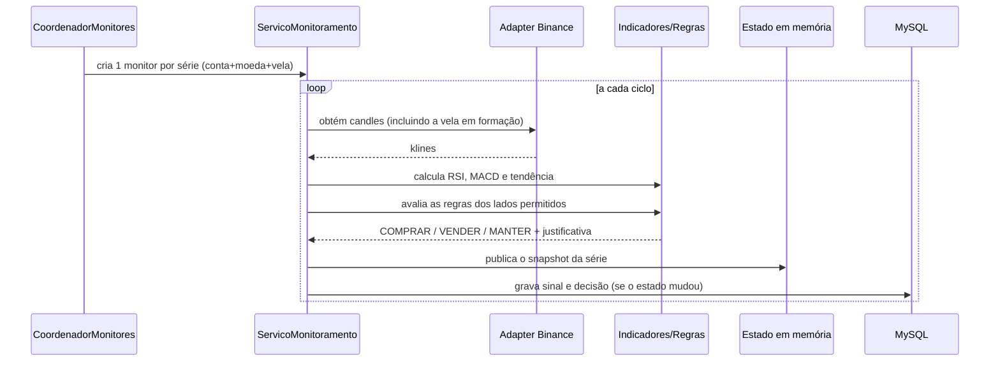
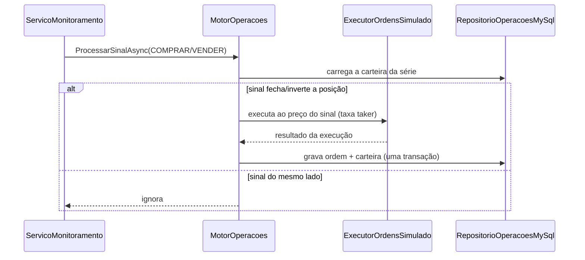
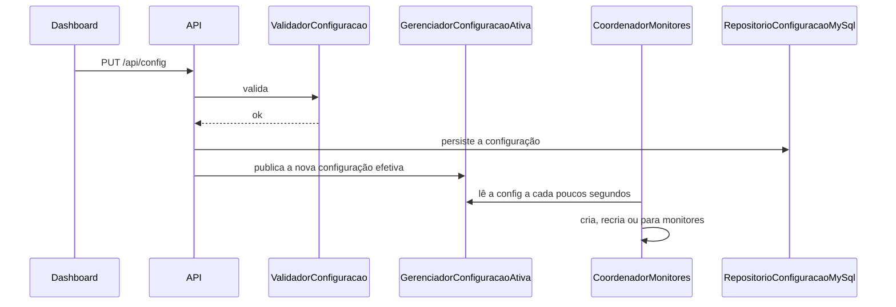

# Arquitetura

Documento de arquitetura do TradingBot: estilo arquitetural, camadas, padrões de
projeto, decisões, fluxos e ambientes. Descreve a solução sem expor as regras de
negócio nem os parâmetros de estratégia usados em produção.

> **Contexto:** projeto de estudo para **levar uma aplicação full stack à
> nuvem** — e para **validar o uso de IA no desenvolvimento**, com a análise e
> as decisões conduzidas por mim (Marcelo Dávila). Ver
> [Propósito de aprendizado](#propósito-de-aprendizado).

## Visão geral

Monorepo em **Ports & Adapters** (arquitetura hexagonal):

- **`TradingBot.Core`** concentra o domínio e depende **apenas** de contratos;
  não referencia infraestrutura nem apresentação.
- **`TradingBot.Api`** é o host: robô + API num processo só. Implementa os
  contratos (Binance, notificação, estado, banco, console) e faz a composição
  por injeção de dependência.
- **`frontend/`** é o dashboard React, que consome a API.
- **`tools/backtest/`** são scripts Node.js usados para análise, fora do
  runtime da aplicação.

| Componente | Responsabilidade |
|------------|------------------|
| `TradingBot.Core` | Indicadores, decisão por regras, monitoramento, operações simuladas, configuração e relatórios |
| `TradingBot.Api` | Composição (DI), adapters de infraestrutura, API REST e apresentação |
| Dashboard React | Visualização do estado, sinais, decisões, operações e configuração |
| MySQL | Persistência opcional de sinais, ordens, carteira, decisões e configuração |
| Binance | Fonte dos candles/ticker (API pública) e das taxas da conta |
| `tools/backtest` | Backtests e validação fora da amostra, com premissas de trade real |

## Camadas

### Domínio (`TradingBot.Core`)

- **Ports** — contratos de tudo que é externo: cliente Binance, notificação,
  visão, estado de mercado, repositórios, executor de ordens, motor de operações,
  estratégias, regras de decisão e fornecedor de configuração.
- **Indicators** — RSI, MACD, tendência por EMA e média (acumulação), além do
  cálculo das séries usadas pelo gráfico.
- **Decisao** — avaliador, fábrica e as **regras plugáveis** de compra e venda.
- **Monitoring** — um serviço por série (conta + símbolo + vela), o serviço de
  preço de referência e o planejador de monitores.
- **Operacoes** — motor de operações fictícias, executor simulado e cálculo de
  taxa.
- **Relatorios** — cálculo de desempenho.
- **Config** — modelos de configuração, validador e sanitizador de segredos.

### Host (`TradingBot.Api`)

- **`Composicao/`** — extensões de DI: robô, persistência e endpoints.
- **`Infrastructure/Binance/`** — adapter do cliente Binance, reconfigurável ao
  vivo quando credenciais ou ambiente mudam.
- **`Infrastructure/Notificacao/`** — canal de aviso plugável (hoje console).
- **`Infrastructure/Estado/`** — snapshot de mercado em memória, thread-safe.
- **`Infrastructure/MySql/`** — conexão, inicializador de banco (DbUp),
  repositórios e migrations em SQL.
- **`Infrastructure/Configuracao/`** — configuração ativa, coordenador de
  monitores, conversores.
- **`Infrastructure/Serializacao/`** — conversor que serializa datas em UTC.
- **`Presentation/`** — visão de console.

### Frontend (`frontend/`)

- **`components/`** — cards, gráfico, painéis e páginas.
- **`hooks/`** — `useEstadoMercado`, que faz o polling do estado.
- **`services/`** — cliente da API.
- **`types/`** e **`utils/`** — tipos espelhando a API e formatação/adaptação do
  widget de gráfico.

## Padrões de projeto

| Padrão | Onde aparece | Para que serve |
|--------|--------------|----------------|
| **Ports & Adapters (hexagonal)** | `Core/Ports` + `Infrastructure/` | Isola o domínio de Binance, banco e console; trocar infraestrutura não mexe na regra |
| **Injeção de dependência / Composition Root** | `Program.cs` e `Composicao/` | Monta o grafo de objetos em um único lugar e define os ciclos de vida |
| **Strategy** | `IEstrategiaRsi`, `IEstrategiaMacd`, `IEstrategiaTendencia`, `IEstrategiaMedia` | Cada indicador é uma estratégia intercambiável, configurável por vela |
| **Regras plugáveis (Strategy + Composite)** | `Decisao/Regras/` com `IRegraDecisao` | Nova regra de compra/venda entra como classe e é registrada na fábrica, sem alterar o monitor |
| **Factory** | `FabricaAvaliadorDecisao`, `FabricaConexaoMySql` | Centraliza a criação a partir da configuração |
| **Repository** | `IRepositorioSinais`, `IRepositorioOrdens`, `IRepositorioCarteira`, `IRepositorioOperacoes`, `IRepositorioDecisoes`, `IRepositorioConfiguracao` | Domínio não conhece SQL; persistência é detalhe de infraestrutura |
| **Unit of Work + transação** | `RepositorioOperacoesMySql` | Ordem e carteira são gravadas juntas, com commit/rollback |
| **Adapter** | `BinanceAPIClient`, `NotificadorConsole`, `VisaoConsole`, repositórios MySQL | Traduz o contrato do domínio para a tecnologia externa |
| **Blackboard / estado compartilhado** | `MemoriaDeEstadoMercado` | Cada monitor publica seu snapshot; a API lê de um ponto único e thread-safe |
| **Máquina de estados** | posição por série (parado / long / short, ou long / caixa) | Torna explícito o que o robô pode fazer em cada estado |
| **Coordinator / reconciliação** | `CoordenadorMonitores` | Compara a configuração desejada com os monitores vivos e cria, recria ou para |
| **Value Object / record** | entidades de `Core/Data` | Dados imutáveis e de leitura direta |
| **Validator + Sanitizer** | `ValidadorConfiguracao`, `ConfiguracaoRoboSanitizador` | Impede configuração inválida e nunca devolve segredos pela API |
| **Migrations versionadas** | `Infrastructure/MySql/Migracoes/*.sql` (DbUp) | Versiona o esquema com histórico aplicado no boot |
| **Null Object / ponto de extensão** | `IExecutorOrdens` com `ExecutorOrdensSimulado` | Hoje simula; a versão real entra como outra implementação, sem mudar o motor |
| **Custom Hook + polling** | `useEstadoMercado` | Encapsula o ciclo de atualização do dashboard |
| **Adapter de UI** | `utils/tradingview.ts` | Isola o widget de gráfico do resto dos componentes |

### Princípios

- **Inversão de dependência de verdade:** o domínio depende de interfaces, e as
  implementações ficam no host — trocar Binance, banco ou canal de aviso é
  escrever um novo adapter.
- **Responsabilidade única:** decisão, execução, indicadores, relatórios e
  configuração vivem em componentes separados.
- **Erros de integração não derrubam o robô:** falhas de API são tratadas no
  loop e a próxima verificação acontece depois.
- **Idioma do domínio em pt-BR**, com termos técnicos mantidos no original
  (`RSI`, `MACD`, `Kline`, `Symbol`).

## Decisões de arquitetura

| # | Decisão | Motivo |
|---|---------|--------|
| 1 | **Ports & Adapters com domínio em biblioteca separada** | Permite testar a regra sem rede nem banco e trocar infraestrutura sem tocar no domínio |
| 2 | **Robô e API no mesmo processo** | Simplicidade operacional: um serviço só para rodar e observar, sem mensageria |
| 3 | **Regras de decisão plugáveis** | Experimentar lógicas novas sem reescrever o monitor |
| 4 | **Configuração editável ao vivo e persistida** | Ajustar contas, moedas, velas e estratégias pelo dashboard, sem reiniciar |
| 5 | **Configuração em banco tem precedência sobre os arquivos** | Garante que o que o dashboard mostra é o que o robô usa |
| 6 | **Execução apenas simulada, com contrato para a real** | Permite medir desempenho sem arriscar capital; a troca é uma nova implementação |
| 7 | **Long-only no Spot** | Reflete o que a conta suporta; short exigiria margem/futuros |
| 8 | **Avaliação intrabar** | O robô decide sobre a vela em formação, como faria em produção |
| 9 | **Registrar decisões só quando o estado muda** | Evita uma linha por ciclo e ainda permite auditar por que uma operação não ocorreu |
| 10 | **Persistência opcional** | A API roda em memória sem banco, o que simplifica o desenvolvimento |
| 11 | **Backtests com premissas de trade real** | Taxa, slippage e preenchimento sem look-ahead; caso contrário o resultado é fantasia |
| 12 | **MySQL com migrations em SQL puro (DbUp)** | Esquema explícito e aplicável no boot do serviço |

## Fluxos

### Ciclo de monitoramento

### Operação simulada

### Configuração ao vivo

## Ambientes

| Ambiente | Característica |
|----------|----------------|
| Local | API e dashboard em portas de desenvolvimento; banco local opcional |
| Nuvem (AWS EC2) | Serviço rodando de forma contínua, dashboard servido por um proxy reverso, banco no próprio host |

Na nuvem, a aplicação roda como **serviço do sistema**, mantida em execução sem
intervenção, e o dashboard é publicado por um proxy reverso à frente do
backend. Nenhum endereço, credencial ou porta interna é divulgado aqui.

## Configuração

Os valores sensíveis ficam **fora do versionamento**, em arquivos de configuração
locais ou variáveis de ambiente. Somente os nomes das seções são documentados:

| Chave | Uso |
|-------|-----|
| `ConnectionStrings:MySql` | Persistência opcional; sem ela, a API roda em memória |
| `Contas[]` | Contas Binance (chaves, ambiente, moedas, velas e estratégias) |
| `Analise:RetencaoDias` | Retenção do histórico de decisões |
| `ApiSeguranca:Token` | Exige header de API key nos endpoints quando preenchido |
| `ASPNETCORE_ENVIRONMENT` | Seleciona o conjunto de configuração por ambiente |

A API devolve a configuração com **segredos mascarados**, e a gravação passa por
validação antes de ser aplicada.

## Segurança

- **Nenhuma chave de API é versionada**: os arquivos de configuração que contêm
  segredos são ignorados pelo Git; em produção, entram por ambiente.
- **Sem transações reais**: a execução de ordens é simulada; o contrato real
  existe, mas não é chamado.
- **Superfície reduzida**: o dashboard é exposto por um proxy; a API pode exigir
  token próprio.
- **Domínio isolado**: a regra de negócio não tem acesso direto a rede nem a
  banco, só aos contratos.
- O repositório público **não contém** código-fonte, parâmetros de estratégia,
  credenciais, endereços internos ou dados de conta.

## Propósito de aprendizado

O projeto existe para **aprender a colocar uma aplicação full stack na nuvem** e
para **praticar engenharia de software num problema que não perdoa
aproximação**: um processo que roda em loop, decide sob incerteza e precisa ser
medido com honestidade.

O que foi praticado:

- **Arquitetura hexagonal** com domínio testável e adapters substituíveis.
- **Engenharia de domínio**: indicadores, regras plugáveis, máquina de estados
  e cálculo de desempenho com taxas.
- **Persistência versionada** e configuração que muda ao vivo.
- **API REST + SPA** refletindo o estado do robô quase em tempo real.
- **Operação em nuvem**: serviço contínuo, proxy reverso e segredos por
  ambiente.
- **Método quantitativo**: backtests com premissas de trade real, comparação
  entre timeframes e validação fora da amostra — inclusive aceitando que os
  resultados não se confirmaram em alguns casos.

### Uso de IA

O projeto também serviu para **validar o uso de IA no desenvolvimento**. A IA
foi usada como ferramenta de implementação, documentação e revisão, sempre sob
direção humana: a análise do problema, o escopo, as decisões de arquitetura, os
critérios de qualidade e a revisão final foram conduzidos por mim (Marcelo
Dávila). O objetivo foi medir, na prática, o ganho de produtividade, os pontos
em que a ferramenta erra e o quanto de revisão crítica o uso de IA exige para
manter a responsabilidade sobre o código entregue.
