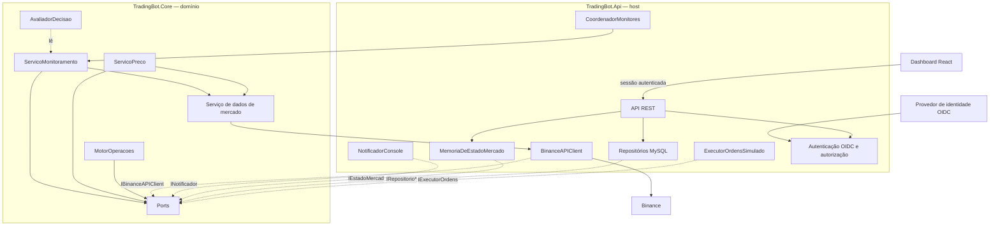
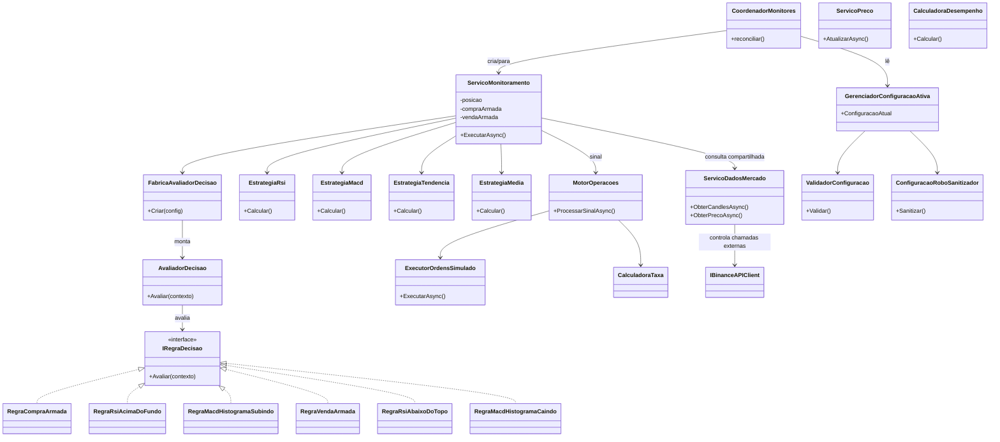
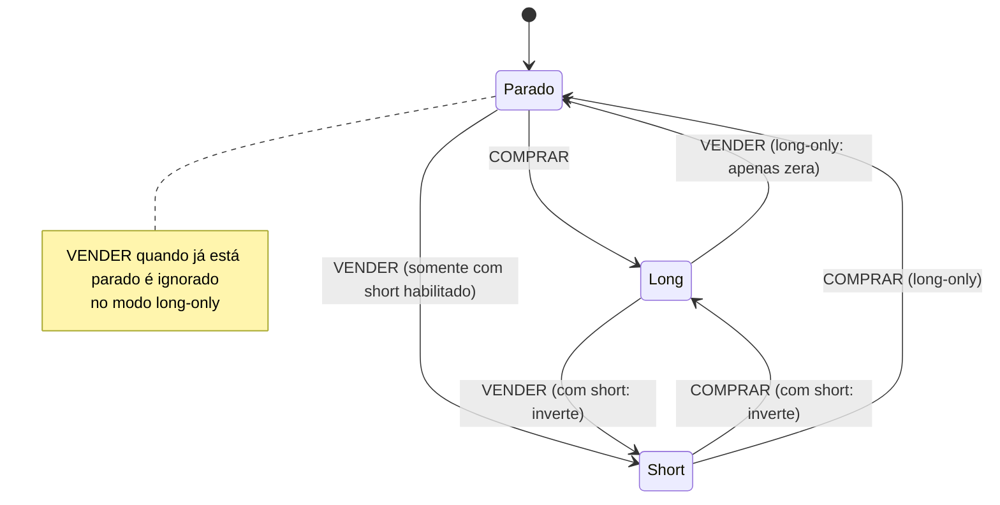
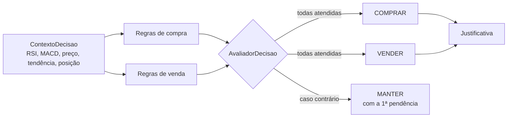
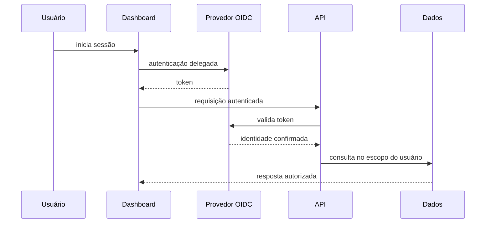

# UML

Diagramas do TradingBot (Mermaid): componentes, contratos, classes do domínio e
a máquina de estados da posição. Mostram a estrutura, sem detalhar os
parâmetros de estratégia.

## Componentes (Ports & Adapters)

O backend valida a identidade delegada e limita cada consulta/configuração ao
usuário autenticado. O provedor externo mantém as credenciais de acesso; o
TradingBot não armazena senhas.

## Ports (contratos do domínio)

```mermaid
classDiagram
    class IBinanceAPIClient
    class IVisao
    class INotificador
    class IEstadoMercado
    class IRepositorioSinais
    class IRepositorioOrdens
    class IRepositorioCarteira
    class IRepositorioOperacoes
    class IRepositorioDecisoes
    class IRepositorioConfiguracao
    class IExecutorOrdens
    class IMotorOperacoes
    class IEstrategiaRsi
    class IEstrategiaMacd
    class IEstrategiaTendencia
    class IEstrategiaMedia
    class IRegraDecisao
    class IFornecedorConfiguracao
    class IServicoDadosMercado
```

## Domínio

## Máquina de estados da posição

## Decisão por regras

## Acesso autenticado

