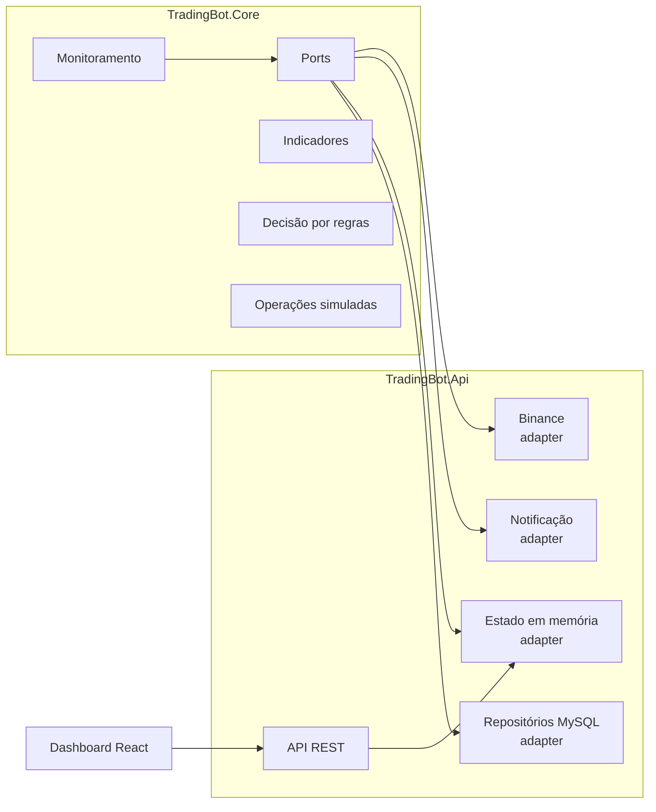

# TradingBot

Robô de **monitoramento de mercado** para a **Binance**: backend em **C#/.NET 9**
e dashboard em **React**. Acompanha indicadores em vários timeframes, decide
compra/venda por regras configuráveis e **simula** as ordens (paper trading, com
taxas) para validar a estratégia ao longo do tempo.

> **Este repositório é a vitrine do projeto.** O código-fonte é privado; aqui
> ficam públicos apenas a ideia, a arquitetura, os padrões de projeto e a
> estrutura de pastas.

**Nenhuma ordem real é enviada.** O robô apenas sinaliza e simula; a execução
real existe como contrato plugável (`IExecutorOrdens`) e está prevista para uma
etapa futura, começando pela testnet.

## Objetivo

Construir um robô de estudo que percorre o ciclo completo de uma estratégia
quantitativa: **ler o mercado → calcular indicadores → decidir → executar em
simulação → medir o resultado**. O foco não é "acertar o mercado", e sim ter um
ambiente honesto para avaliar se uma regra se sustenta — inclusive comparando o
que ela faria em janelas que não foram usadas para ajustá-la.

- Sistemas **long-only no Spot** (não há short na configuração executável).
- Operações **fictícias** (paper trading), com **taxa taker** e premissas
  realistas de preenchimento.
- Toda a análise é feita sobre **dados públicos** de mercado da Binance.

## Propósito de aprendizado

Projeto de estudo para **levar uma aplicação full stack à nuvem**, com um tema
que exige decisões de engenharia de verdade: um processo que roda em loop,
consistência de dados, configuração que muda ao vivo e um dashboard que reflete
o estado do robô.

O que foi praticado:

- **Arquitetura em Ports & Adapters** (domínio isolado de infraestrutura).
- **Backend .NET** com API REST, injeção de dependência, persistência
  versionada e testes unitários.
- **SPA em React** consumindo a API em tempo quase real.
- **Deploy em nuvem (AWS EC2)** com proxy reverso e execução como serviço.
- **Análise quantitativa**: backtests em Node com premissas de trade real, taxa,
  slippage e validação fora da amostra.

## Uso de IA

O desenvolvimento contou com **apoio de assistentes de IA** para implementação,
documentação e revisão. A condução foi humana: a análise do problema, o escopo,
as decisões de arquitetura, os critérios de qualidade e a validação do que foi
entregue foram definidos e revisados por mim (Marcelo Dávila). A IA atuou como
ferramenta sob direção, não de forma autônoma.

Além do aprendizado em nuvem, o projeto serviu para **validar o uso de IA no
desenvolvimento** na prática — quanto ela acelera, onde erra, quanto exige
revisão e como manter responsabilidade sobre o código final.

## Funcionalidades

- **Leitura de candles** (klines) de uma ou mais contas Binance, com ambiente de
  testnet ou leitura pública de produção.
- **Indicadores configuráveis por vela**: RSI, MACD e tendência por médias
  exponenciais, além de um **modo acumulação** por média.
- **Decisão por regras plugáveis**, cada sinal com justificativa, e **aviso em
  compra/venda por canal plugável**.
- **Multi-timeframe e multi-conta**: cada conta tem suas moedas, velas e
  estratégia próprias, com carteira independente.
- **Operações fictícias** com P&L, taxas e relatório de desempenho (acerto,
  ganho/perda, P&L bruto/taxas/líquido, tempo médio).
- **Configuração editável pelo dashboard**, validada, persistida e aplicada
  **ao vivo**, sem reiniciar o processo.
- **Registro das decisões**: o estado e o resultado de cada regra, gravados
  apenas quando o estado muda, permitindo investigar **por que uma operação não
  aconteceu**.
- **Dashboard React** com gráfico TradingView, painel de decisões, sinais,
  operações, desempenho por vela e tela de configuração.

## Stack

| Camada      | Tecnologia                                                     |
|-------------|----------------------------------------------------------------|
| Backend     | C# / .NET 9, ASP.NET Core, injeção de dependência              |
| Domínio     | Biblioteca `TradingBot.Core` (Ports & Adapters)                |
| Indicadores | `Skender.Stock.Indicators`                                     |
| Dados       | API pública da Binance (klines e ticker)                       |
| Banco       | MySQL (opcional), migrations versionadas com DbUp              |
| Frontend    | React + Vite + TypeScript                                      |
| Análise     | Scripts de backtest em Node.js                                 |
| Testes      | xUnit (domínio: indicadores, decisão, operações e desempenho)  |

## Arquitetura

O domínio fica isolado em `TradingBot.Core` e conversa com o mundo apenas por
**contratos** (`Core/Ports`). As implementações — Binance, notificação, estado,
banco e console — vivem no host `TradingBot.Api` e são ligadas por injeção de
dependência.



Detalhes, decisões e fluxos em [`Docs/ARQUITETURA.md`](Docs/ARQUITETURA.md).

## Estratégia (visão geral)

A lógica é de **reversão com confirmação de momentum**:

- o RSI marca os extremos (sobrevenda/sobrecompra) e **arma** o lado;
- a confirmação vem do **histograma do MACD** virando na direção do sinal;
- um **filtro de tendência** (médias exponenciais da própria vela) só permite
  compra em tendência de alta e venda em tendência de baixa;
- todos os parâmetros são **configuráveis por vela** e por série
  (conta + moeda + timeframe).

O robô é uma **máquina de estados**: fica parado até o primeiro sinal válido e,
a partir daí, o sinal oposto fecha a posição — invertendo apenas se o short
estiver habilitado (por padrão, não está: é Spot, long-only).

**Backtests (resultado qualitativo).** Os scripts em `tools/backtest/` usam
premissas de trade real (taxa taker, slippage, preenchimento no preço do sinal,
sem look-ahead) e validam fora da amostra. A conclusão foi que, **sem o filtro
de tendência, a reversão perde em todas as velas testadas**; **com o filtro**,
os timeframes maiores (1h, 4h e 1d) ficam positivos numa janela de ~9 anos,
enquanto os muito curtos (5m e 15m) continuam inviáveis porque a taxa consome o
movimento. Ajustar parâmetros em cima do histórico não se sustentou fora da
amostra — o que reforça o valor da validação walk-forward.

## Endpoints da API

| Método | Rota                     | Descrição                                                        |
|--------|--------------------------|------------------------------------------------------------------|
| GET    | `/api/estado`            | Snapshot atual de cada combinação conta + símbolo + vela          |
| GET    | `/api/estado/{simbolo}`  | Snapshot de um símbolo                                           |
| GET    | `/api/sinais`            | Sinais registrados (com justificativa), com filtros               |
| GET    | `/api/ordens`            | Ordens fictícias, com filtros                                     |
| GET    | `/api/carteira`          | Carteira simulada por conta + símbolo + vela                      |
| GET    | `/api/desempenho`        | Desempenho: acerto, P&L bruto, taxas e líquido                    |
| GET    | `/api/series`            | Candles e séries de RSI/MACD para o gráfico                       |
| GET    | `/api/acumulacao`        | Série do modo acumulação                                          |
| GET    | `/api/decisoes`          | Histórico de decisões (estado + resultado de cada regra)          |
| GET    | `/api/decisoes.csv`      | Exportação do histórico de decisões em CSV                        |
| GET    | `/api/config`            | Configuração efetiva (segredos mascarados)                        |
| PUT    | `/api/config`            | Valida, persiste e aplica a configuração ao vivo                  |

Opcionalmente, os endpoints podem exigir um header de API key
(`ApiSeguranca:Token`), pensado para expor o dashboard sem deixar a API aberta.

## Estrutura

Árvore completa (sem o conteúdo dos arquivos) em
[`Docs/ESTRUTURA.md`](Docs/ESTRUTURA.md). Resumo:

```
TradingBot/
├── backend/
│   ├── src/TradingBot.Core/     domínio: Ports, Indicators, Decisao, Monitoring, Operacoes
│   ├── src/TradingBot.Api/      host: Composicao (DI), Infrastructure, Presentation
│   └── tests/TradingBot.Tests/  testes unitários do domínio
├── frontend/src/                dashboard React: components, hooks, services, types, utils
├── tools/backtest/              scripts de backtest e validação (Node.js)
└── docs/                        arquitetura, configuração, execução e planos
```

## Execução (resumo)

```bash
dotnet build backend/TradingBot.sln          # backend
dotnet test  backend/TradingBot.sln          # testes do domínio
dotnet run --project backend/src/TradingBot.Api
npm install && npm run dev                   # frontend (dashboard)
```

A configuração é **por ambiente** e fica fora do versionamento (as chaves de API
nunca vão para o repositório). Sem banco configurado, a API roda apenas com
estado em memória — sem ordens fictícias.

## Documentação

- [Arquitetura, padrões de projeto e decisões](Docs/ARQUITETURA.md)
- [UML](Docs/UML.md)
- [Estrutura de pastas](Docs/ESTRUTURA.md)

## Avisos

- Projeto **educacional**. Não é recomendação de investimento e não promete
  resultado.
- O robô **não envia ordens reais**: as operações são simuladas.
- Dados de mercado obtidos da API pública da Binance; o projeto não tem
  vínculo com a Binance.
